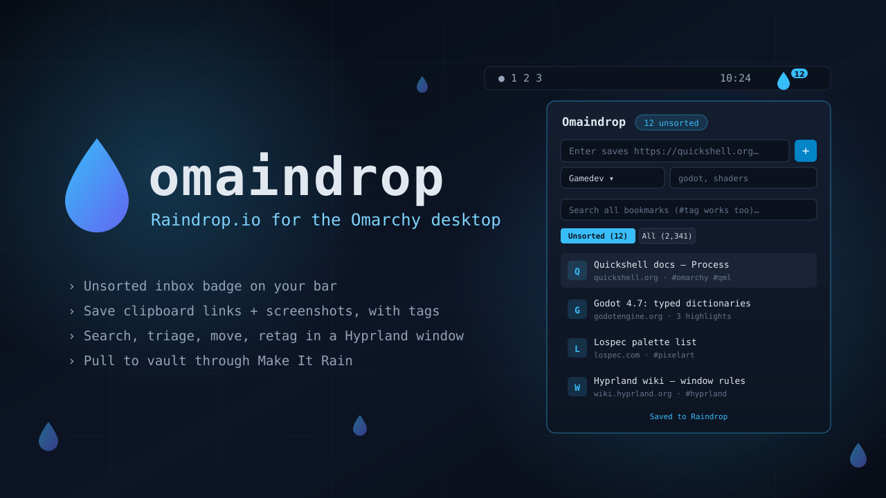

<div align="center">



# Omaindrop

**Raindrop.io Bookmarks for the Omarchy Desktop**

[](https://omarchy.org)
[](https://quickshell.outfoxxed.me)
[](LICENSE)
[](https://developer.raindrop.io)

</div>

---

**Omaindrop** is an Omarchy shell plugin that puts your [Raindrop.io](https://raindrop.io) library directly into your desktop workflow. Keep your Unsorted inbox count on the bar, throw links and screenshots into any collection with tags in two keystrokes, triage everything in a full desktop window that can float and tile inside Hyprland, and pull it all into Obsidian with [Make It Rain](https://github.com/frostmute/make-it-rain).

---

## ✨ Features

- 📊 **Status Bar Integration**:
  - Live badge with your **Unsorted** count (turns urgent past a threshold you choose).
  - Pulsing dot while a save or upload is in flight; dims when no token is set.
  - **Left-Click**: Toggle the quick popup panel.
  - **Middle-Click**: Summon the floating/tiling desktop window.
  - **Right-Click**: Refresh counts, collections, and tags.

- ⚡ **Quick Status Popup**:
  - Anchored directly beneath the bar widget icon.
  - **Save from clipboard**: open the popup and a copied link is already queued — just hit `Enter`.
  - Pick the **collection** and type **tags** for the next save, right there.
  - 📸 **Screenshot to Raindrop**: select a region (`slurp` + `grim`) and it's uploaded into the chosen collection with your tags.
  - Live search across your whole library (Raindrop's own syntax works: `#tag`, `site:`, etc.).
  - `Unsorted` / `All` views, click a bookmark to open it, hover to copy the link or send it to Trash.
  - **Pull to vault** (`󰇚`) — only shows up when Make It Rain is installed in one of your vaults.

- 🪟 **Hyprland-Native Desktop Window**:
  - A Wayland XDG toplevel window (`FloatingWindow`) that can **float or tile** seamlessly within Hyprland.
  - Centered floating window ($1040 \times 700$) by default; toggle between tiling and floating with `Super + T`.
  - Sidebar with every collection (nested, with counts) and your most-used tags as one-click filters.
  - Inspector: excerpt, note, created date, **retag**, **move to collection**, open, copy, trash.
  - Built for inbox-zero triage: select, move, next.

- 🌧️ **Make It Rain Hand-off**:
  - Omaindrop finds every Obsidian vault with [Make It Rain](https://github.com/frostmute/make-it-rain) installed (the open vault wins).
  - With [Advanced URI](https://github.com/Vinzent03/obsidian-advanced-uri) installed, **Pull to vault** fires Make It Rain's `Fetch raindrops` command directly. Without it, the vault opens and the fetch is one `Ctrl + P` away.
  - Already set up Make It Rain? Omaindrop can reuse its saved token, so there's nothing to configure.

- 🛡️ **Security & Performance**:
  - Built strictly on Omarchy's `qs.Commons` and `qs.Ui` design kit — follows your theme.
  - Strict `Text.PlainText` rendering for everything that comes from the web (titles, excerpts, notes, tags).
  - Standard-library Python bridge, no pip installs; every command answers with one JSON object.
  - Token file written `0600`; only `http(s)` links are ever saved or opened.
  - Last good counts and lists are cached, so the badge survives going offline.
  - Polls every 2 minutes — well under Raindrop's 120 requests/minute limit.

---

## 🚀 Installation

Install and place Omaindrop on your bar in one command:

```bash
omarchy plugin add https://github.com/frostmute/omaindrop --enable
omarchy bar put io.github.frostmute.omaindrop --section right
```

### 🔑 Raindrop token

Omaindrop talks to Raindrop with a personal **test token**:

1. Open [app.raindrop.io/settings/integrations](https://app.raindrop.io/settings/integrations).
2. Under **For Developers**, click **Create new app** (any name, e.g. `Omaindrop`).
3. Open the app and click **Create test token**, then copy it.
4. Click the Omaindrop icon in your bar and paste it into the popup — it's verified and saved for you.

In Bash, run this block and paste your token at the prompt:

```bash
(
  IFS= read -r -s -p "Raindrop token: " token || exit 1
  printf '\n' >&2
  builtin printf '%s\n' "$token" |
    ~/.config/omarchy/plugins/io.github.frostmute.omaindrop/bin/omaindrop-backend set-token
)
```

Omaindrop looks for a token in this order, first hit wins:

| Order | Source | Notes |
|---|---|---|
| 1 | `$RAINDROP_TOKEN` | Handy for testing |
| 2 | `~/.config/omaindrop/config.json` → `"token"` | |
| 3 | `~/.config/raindrop/token` (or `$RAINDROP_TOKEN_FILE`) | Where the popup saves it; shared with other Raindrop tools |
| 4 | Make It Rain's saved token in your Obsidian vault | Turn off with `"useMakeItRainToken": false` |

**That's it!** No compositor restarts required.

### Opening Omaindrop
- **Quick Popup**: Click the `󰖌` icon in your bar.
- **Desktop Window**: Middle-click the bar icon, or click `↗` inside the popup header.
- **Hyprland Native**: The desktop window is managed natively by Hyprland — press `Super + T` anytime to toggle between floating and tiling, drag to move, or snap to workspaces.

---

## ⌨️ Shortcuts & Controls

| Shortcut / Action | Context | Description |
|---|---|---|
| `Left-Click` | Bar icon | Open / close the quick popup panel |
| `Middle-Click` | Bar icon | Toggle the full desktop window |
| `Right-Click` | Bar icon | Refresh counts, collections, and tags |
| `Enter` | Popup link field | Save the typed link (or the queued clipboard link) |
| `Esc` | Popup search | Clear the search |
| `/` | Desktop window | Focus search |
| `n` | Desktop window | Focus the save field |
| `r` | Desktop window | Refresh |
| `o` | Desktop window | Open the selected bookmark |
| `Del` | Desktop window | Send the selected bookmark to Trash |
| `Double-Click` | Desktop window list | Open the bookmark |
| `Super + T` | Window focused | Toggle between floating and tiling (Hyprland native) |
| `Esc` | Popup / Window | Close current surface |

*(Optional)* Global keybinds for `~/.config/hypr/bindings.lua`:
```lua
o.bind("SUPER + ALT + R", "Omaindrop: save clipboard link", "omarchy-shell omaindrop saveClipboard")
o.bind("SUPER + ALT + SHIFT + R", "Omaindrop: screenshot to Raindrop", "omarchy-shell omaindrop screenshot")
o.bind("SUPER + ALT + B", "Omaindrop: toggle desktop window", "omarchy-shell shell toggle io.github.frostmute.omaindrop")
```

IPC methods on the `omaindrop` target: `toggle`, `open`, `close`, `refresh`, `saveClipboard`, `save <url>`, `screenshot`, `pull`, `openWindow`.

---

## ⚙️ Configuration

Everything is optional. `~/.config/omaindrop/config.json`:

```json
{
  "defaultCollection": -1,
  "vault": "Brain",
  "pullCommand": "make-it-rain:fetch-raindrops",
  "useMakeItRainToken": true
}
```

| Key | Default | What it does |
|---|---|---|
| `token` | — | Raindrop test token (see the lookup order above) |
| `defaultCollection` | `-1` (Unsorted) | Where saves land unless you pick another collection (popup, window, keybinds). Collection ids are in the URL at app.raindrop.io |
| `vault` | the open vault | Which Make It Rain vault **Pull to vault** targets |
| `pullCommand` | `make-it-rain:fetch-raindrops` | Any Obsidian command id, e.g. one of your Make It Rain presets: `make-it-rain:fetch-preset-<id>` |
| `useMakeItRainToken` | `true` | Allow reading Make It Rain's saved token as a last resort |

Badge threshold lives with the widget in `~/.config/omarchy/shell.json`, e.g. `{ "id": "io.github.frostmute.omaindrop", "warnAt": 25 }` (default `50`).

---

## 🧰 The Bridge

`bin/omaindrop-backend` is a standalone CLI, so it's scriptable too. Every command prints one JSON object (`"ok": true|false`) and exits non-zero on failure.

| Command | Does |
|---|---|
| `count` | Unsorted / all / trash counts (falls back to cache offline) |
| `recent [--collection ID] [--limit N]` | Newest bookmarks (default: Unsorted) |
| `search QUERY [--collection ID]` | Search (Raindrop syntax) |
| `save [URL] [--collection ID] [--tags a,b] [--title T]` | Save a link — no URL means the clipboard |
| `screenshot [--full] [--file PNG] [--collection ID] [--tags a,b]` | Region/fullscreen capture, or upload a file |
| `collections` / `tags` | Nested collections with counts / tags by use |
| `move ID COLLECTION` · `tag ID a,b [--append]` · `delete ID` | Triage |
| `vault` · `pull [--vault NAME] [--dry-run]` | Make It Rain detection and hand-off |
| `status [--check]` · `set-token` (reads from stdin) | Token status / verify and store |

---

## 🗑️ Removal & Uninstallation

To remove Omaindrop from your Omarchy configuration:

```bash
omarchy plugin disable io.github.frostmute.omaindrop
omarchy plugin remove io.github.frostmute.omaindrop --yes
```

Your token stays in `~/.config/raindrop/token` and the cache in `~/.cache/omaindrop/` — delete them if you're done with Raindrop on this machine.

---

## 📦 Architecture

```
omaindrop/
├── manifest.json       Plugin manifest (kinds: bar-widget, panel)
├── BarWidget.qml       Bar button, Unsorted badge, IPC, and popout coordinator
├── PopupPanel.qml      Quick popup: save, screenshot, search, recent
├── Window.qml          Hyprland floating/tiling desktop window
├── DropClient.qml      Reactive process manager and data store
├── bin/
│   └── omaindrop-backend Raindrop REST v1 bridge (Python stdlib, JSON out)
├── tests/
│   └── test_backend.py Bridge tests against a fake Raindrop API
├── assets/
│   ├── hero.svg        Vector hero artwork
│   └── preview.png     Rendered 16:9 banner preview
├── preview.png         Marketplace listing thumbnail
├── LICENSE             MIT License
└── README.md           Documentation
```

---

## 🔧 Prerequisites

- **Omarchy Linux** (Quattro shell with Hyprland).
- **Python 3** (ships with Omarchy).
- **A Raindrop.io account** and a test token (free accounts work).
- `wl-clipboard` for clipboard saves, `grim` + `slurp` for screenshots — all part of a stock Omarchy install.
- *(Optional)* **Obsidian** with **Make It Rain**, plus **Advanced URI** for one-click pulls.

---

## 🧪 Tests

```bash
python3 -m unittest discover -s tests -v
```

The suite spins up a local fake of the Raindrop API and drives the real bridge against it: counts, offline cache, search, nested collections, saves (explicit, clipboard, default collection), multipart screenshot upload, move/retag/trash, 401/404/429 handling, token lookup order, and the Make It Rain hand-off.

---

## 📄 License

Distributed under the [MIT License](LICENSE). Built for the [Omarchy](https://omarchy.org) desktop ecosystem.
